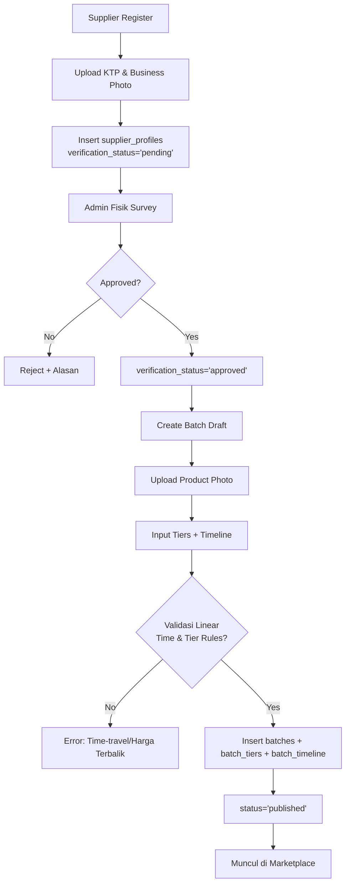
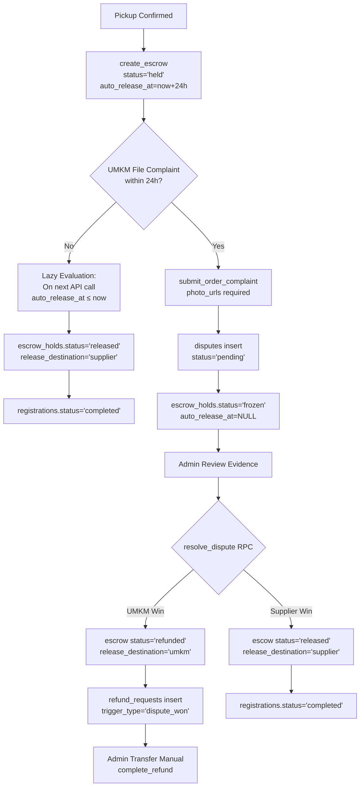
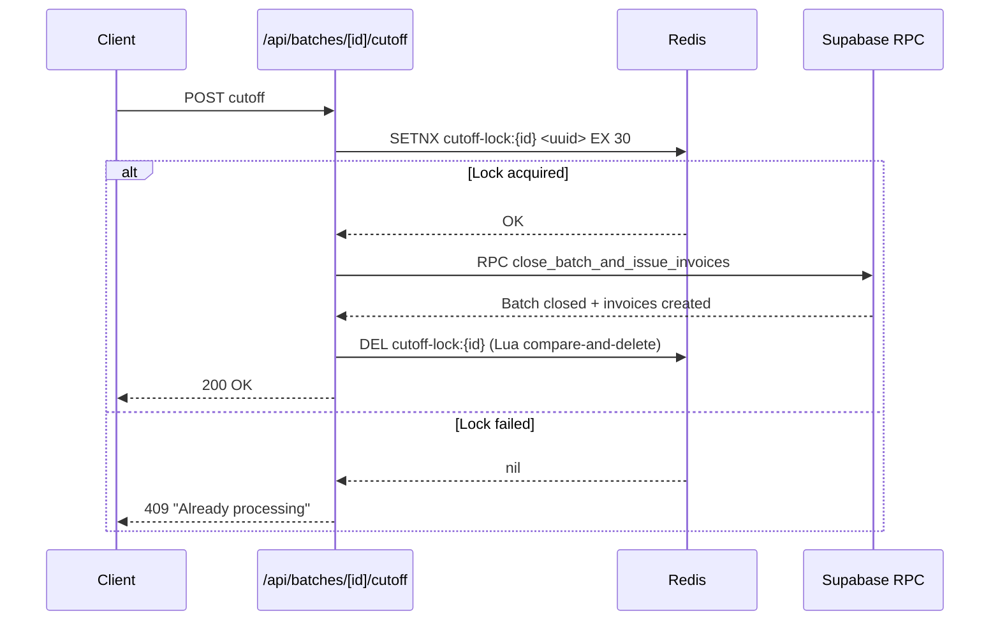

# Arsitektur Sistem Wesup

Platform *group-buying* bahan baku UMKM dengan model *self-pickup* (Bandung only). Competition entry INSEVENT 2026 — SDG 8.

---

## 1. Gambaran Umum Arsitektur

```
┌─────────────────────────────────────────────────────────────────────────────┐
│                           NEXT.JS 16 (APP ROUTER)                          │
│  ┌──────────────┐  ┌──────────────┐  ┌──────────────┐  ┌──────────────┐   │
│  │   Frontend   │  │  API Routes  │  │  Middleware  │  │   Server     │   │
│  │  (React 19)  │  │  (Server)    │  │  (Auth/CSRF) │  │  Components  │   │
│  └──────┬───────┘  └──────┬───────┘  └──────┬───────┘  └──────┬───────┘   │
│         │                 │                 │                 │            │
└─────────┼─────────────────┼─────────────────┼─────────────────┼────────────┘
          │                 │                 │                 │
          ▼                 ▼                 ▼                 ▼
┌─────────────────────────────────────────────────────────────────────────────┐
│                            SUPABASE (POSTGRESQL)                           │
│  ┌─────────────┐ ┌─────────────┐ ┌─────────────┐ ┌─────────────────────┐  │
│  │   Tables    │ │   Views     │ │  Functions  │ │      Storage        │  │
│  │  (RLS)      │ │  (RPC)      │ │ (SECURITY   │ │  (wesup-assets/     │  │
│  │             │ │             │ │  DEFINER)   │ │   wesup-public)     │  │
│  └─────────────┘ └─────────────┘ └─────────────┘ └─────────────────────┘  │
└─────────────────────────────────────────────────────────────────────────────┘
          │                 │                 │                 │
          ▼                 ▼                 ▼                 ▼
┌─────────────────────────────────────────────────────────────────────────────┐
│                         UPSTASH REDIS (SERVERLESS)                         │
│  ┌─────────────────┐  ┌─────────────────┐  ┌────────────────────────────┐  │
│  │ Atomic Counter  │  │ Distributed     │  │ Rate Limiting              │  │
│  │ (INCR)          │  │ Lock (SETNX)    │  │ (Per-user, Per-endpoint)   │  │
│  └─────────────────┘  └─────────────────┘  └────────────────────────────┘  │
└─────────────────────────────────────────────────────────────────────────────┘
          │
          ▼
┌─────────────────────────────────────────────────────────────────────────────┐
│                           EXTERNAL SERVICES                                 │
│  ┌──────────────┐  ┌──────────────┐  ┌──────────────┐  ┌──────────────┐   │
│  │  MIDTRANS    │  │  FONNTE/     │  │  VERCEL      │  │  SUPABASE    │   │
│  │  (QRIS)      │  │  WHATSAPP    │  │  (Hosting)   │  │  AUTH        │   │
│  └──────────────┘  └──────────────┘  └──────────────┘  └──────────────┘   │
└─────────────────────────────────────────────────────────────────────────────┘
```

---

## 2. Entity Relationship Diagram (ERD)

```mermaid
erDiagram
    AUTH_USERS ||--|| PROFILES : "1:1"
    PROFILES {
        uuid id PK
        user_role role
        account_status status
        text full_name
        text email
        text phone
    }
    PROFILES ||--|| SUPPLIER_PROFILES : "1:1"
    SUPPLIER_PROFILES {
        uuid user_id PK,FK
        text business_name
        text address
        numeric latitude
        numeric longitude
        text nik UK
        text ktp_photo_url
        text business_photo_url
        verification_status status
    }
    PROFILES ||--|{ SUPPLIER_BANK_ACCOUNTS : "1:N"
    PROFILES ||--|| UMKM_PROFILES : "1:1"
    UMKM_PROFILES {
        uuid user_id PK,FK
        integer strike_count
        timestamptz suspended_until
        text business_name
        text address
        numeric latitude
        numeric longitude
    }
    PROFILES ||--|{ UMKM_BANK_ACCOUNTS : "1:N"
    
    PROFILES ||--|{ BATCHES : "1:N (supplier)"
    BATCHES {
        uuid id PK
        uuid supplier_id FK
        uuid recurring_config_id FK
        text title
        text description
        batch_category category
        integer min_quantity
        text product_photo_url
        text pickup_name
        text pickup_address
        numeric latitude
        numeric longitude
        batch_status status
    }
    
    BATCHES ||--|{ BATCH_TIERS : "1:N"
    BATCH_TIERS {
        uuid id PK
        uuid batch_id FK
        integer tier_number
        integer min_volume
        integer max_volume
        numeric price_per_unit
    }
    
    BATCHES ||--|| BATCH_TIMELINE : "1:1"
    BATCH_TIMELINE {
        uuid batch_id PK,FK
        timestamptz registration_opens_at
        timestamptz registration_closes_at
        timestamptz payment_opens_at
        timestamptz payment_closes_at
        timestamptz estimated_ready_at
        timestamptz effective_payment_opens_at
        timestamptz effective_payment_closes_at
        timestamptz pickup_ends_at
    }
    
    BATCHES ||--|{ REGISTRATIONS : "1:N"
    REGISTRATIONS {
        uuid id PK
        uuid batch_id FK
        uuid umkm_id FK
        integer quantity
        jsonb consent_terms
        timestamptz consented_at
        numeric consent_latitude
        numeric consent_longitude
        registration_status status
        integer locked_tier_number
        numeric locked_price_per_unit
        numeric final_amount
        text cancellation_reason
    }
    
    REGISTRATIONS ||--|| REGISTRATION_COUNTERS : "1:1"
    REGISTRATION_COUNTERS {
        uuid batch_id PK,FK
        bigint current_count
    }
    
    REGISTRATIONS ||--|| PAYMENTS : "1:1"
    PAYMENTS {
        uuid id PK
        uuid registration_id FK UK
        text midtrans_order_id UK
        text midtrans_transaction_id
        numeric gross_amount
        payment_status status
        text qr_code_url
        timestamptz qr_code_expires_at
        timestamptz paid_at
        jsonb webhook_payload
    }
    
    REGISTRATIONS ||--|| PICKUP_CODES : "1:1"
    PICKUP_CODES {
        uuid id PK
        uuid registration_id FK UK
        text qr_code_token UK
        text pin_code
        timestamptz used_at
        uuid used_by_supplier_id FK
    }
    
    REGISTRATIONS ||--|{ PICKUP_EVENTS : "1:N"
    PICKUP_EVENTS {
        uuid id PK
        uuid registration_id FK
        uuid supplier_id FK
        pickup_method method
        numeric latitude
        numeric longitude
        text notes
        timestamptz created_at
    }
    
    REGISTRATIONS ||--|| ESCROW_HOLDS : "1:1"
    ESCROW_HOLDS {
        uuid id PK
        uuid registration_id FK UK
        numeric amount
        timestamptz pickup_confirmed_at
        timestamptz auto_release_at
        timestamptz released_at
        escrow_status status
        text release_destination
        uuid dispute_id FK
    }
    
    REGISTRATIONS ||--|| DISPUTES : "1:1"
    DISPUTES {
        uuid id PK
        uuid registration_id FK UK
        uuid umkm_id FK
        uuid supplier_id FK
        dispute_status status
        text complaint_category
        text description
        jsonb photo_urls
        uuid admin_id FK
        text admin_notes
        timestamptz decided_at
    }
    
    DISPUTES ||--|{ DISPUTE_EVIDENCE : "1:N"
    DISPUTE_EVIDENCE {
        uuid id PK
        uuid dispute_id FK
        text file_url
        uuid uploaded_by FK
    }
    
    REGISTRATIONS ||--|{ REFUND_REQUESTS : "1:N"
    REFUND_REQUESTS {
        uuid id PK
        uuid registration_id FK
        uuid batch_id FK
        refund_trigger trigger_type
        numeric amount
        uuid umkm_bank_account_id FK
        uuid admin_id FK
        text admin_notes
        text transfer_proof_url
        refund_status status
    }
    
    REGISTRATIONS ||--|| RATINGS : "1:1"
    RATINGS {
        uuid id PK
        uuid registration_id FK UK
        integer score
        text comment
    }
```

---

## 3. Flowchart Alur Kerja Utama

### 3.1 Alur Supplier Onboarding → Publish Batch



### 3.2 Alur UMKM Join Batch → Payment → Pickup → Escrow

```mermaid
flowchart TD
    A[UMKM Browse Marketplace] --> B[Filter Radius/Kategori/Harga]
    B --> C[View Detail Batch]
    C --> D[Centang Consent Lokasi<br/>+ Timestamp Recorded]
    D --> E[POST /api/registrations]
    E --> F{API Gatekeeper:<br/>registration_opens ≤ now < registration_closes?}
    F -->|No| G[403: Belum Buka / Sudut Tutup]
    F -->|Yes| H[Redis INCR Atomic Counter]
    H --> I{Kapasitas Cukup?}
    I -->|No| J[409: Kapasitas Penuh]
    I -->|Yes| K[Insert registrations<br/>status='registered']
    K --> L[Real-time Progress Bar Update]
    L --> M[Registration Window Closes]
    M --> N[POST /api/batches/[id]/cutoff<br/>(Redis SETNX Lock)]
    N --> O[RPC cut_off_batch / close_batch_and_issue_invoices]
    O --> P[Reconcile Volume dari registrations]
    P --> Q[Lock Tier & Price per Unit<br/>Fallback ke Tier 1]
    Q --> R[batches.status='closed']
    R --> S[Generate Midtrans QRIS Invoice]
    S --> T[UMKM Bayar di Payment Window]
    T --> U{Midtrans Webhook<br/>paid?}
    U -->|No - Expired| V[Hit-and-Run Strike<br/>Escalation]
    U -->|Yes| W[payments.status='paid'<br/>registrations.status='paid']
    W --> X[Generate Pickup Code QR/PIN]
    X --> Y[Supplier Scan QR / Input PIN]
    Y --> Z[POST /api/pickups/[id]/confirm]
    Z --> AA[RPC confirm_pickup]
    AA --> AB[create_escrow<br/>auto_release_at = now + 24h]
    AB --> AC[registrations.status='picked_up']
    AC --> AD{24h Passed + No Dispute?}
    AD -->|Yes| AE[Auto-Release → Supplier]
    AD -->|Dispute Filed| AF[Escrow Frozen<br/>auto_release_at=NULL]
    AF --> AG[Admin Arbitration]
    AG --> AH{Dispute Resolved}
    AH -->|UMKM Win| AI[Full Refund Queue]
    AH -->|Supplier Win| AJ[Release → Supplier]
```

### 3.3 Alur Escrow & Dispute Resolution



---

## 4. Diagram Arsitektur Sistem (Layered View)

### 4.1 Presentation Layer (Frontend)
- **Next.js App Router** + React 19
- **Client Components**: Marketplace, ProductCard, Dashboard, Pickup QR Scanner
- **Server Components**: SEO pages, Initial data fetch
- **Tailwind CSS 4** + Swiss Industrial Brutalist Design System (`DESIGN.md`)
- **State Management**: TanStack Query (server state), React Context (auth)

### 4.2 API Layer (Backend)
```
app/api/
├── auth/                 # Login, Logout, Password Reset, Session
├── marketplace/
│   └── search/route.ts   # Optimized single-query search (RPC search_batches)
├── registrations/route.ts    # Join batch + Gatekeeper validation
├── batches/[id]/cutoff/      # Volume-limiting Gatekeeper (SETNX lock)
├── pickups/[id]/
│   ├── code/route.ts         # Generate QR/PIN
│   └── confirm/route.ts      # Confirm pickup → create escrow
├── webhook/midtrans/route.ts # Payment callback handler
├── admin/                  # Admin-only RPC proxies
└── umkm/orders/            # UMKM order dashboard + pickup decision
```

### 4.3 Business Logic Layer (Lib)
```
lib/
├── supabase/
│   ├── client.ts         # Browser client
│   ├── server.ts         # Cookie-based server client (Structural DI)
│   └── auth.ts           # Role/status guards, AuthError
├── orders/
│   ├── time-gatekeeper.ts    # Pure time evaluation (no I/O)
│   └── registration-counter.ts # Redis atomic ops + SETNX
├── transactions/
│   ├── registration.ts   # joinVersionedBatch, withRegistrationLock
│   └── early-payment.ts  # Policy v2 early payment logic
├── marketplace/
│   ├── api-mapper.ts     # RPC row → MarketplaceItem DTO
│   ├── list-context.ts   # Batch enrichment (now inlined in RPC)
│   ├── origin.ts         # Location resolution (UMKM profile / default)
│   └── types.ts          # MarketplaceItem, Tier, Origin types
├── catalog/categories.ts # Category enum + validation
├── rate-limit.ts         # Per-endpoint rate limiting
├── redis.ts              # Upstash client (throws if env missing)
└── performance/
    ├── server-timing.ts  # RequestTiming for phase measurement
    └── read-budget.ts    # 8s timeout wrapper
```

### 4.4 Data Layer (Supabase)
- **PostgreSQL 16** dengan Row Level Security (RLS) di setiap tabel
- **Security Definer Functions** (RPC) untuk:
  - Mutations yang butuh bypass RLS (cutoff, escrow, dispute)
  - Aggregations kompleks (search_batches, get_marketplace_batch)
  - Admin actions dengan audit log atomic
- **Storage Buckets**:
  - `wesup-assets` (private): KTP, business photo, dispute evidence
  - `wesup-public` (public): Product photos
- **Auth**: Supabase Auth + custom `profiles` table (role, status)

### 4.5 Cache & Coordination Layer (Upstash Redis)
| Use Case | Mechanism | Key Pattern |
|----------|-----------|-------------|
| Volume Counter | `INCRBY` atomic | `batch:{id}:count` |
| Reservation | Lua Script (check+incr) | `batch:{id}:count` |
| Cutoff Lock | `SETNX` + UUID token + TTL 30s | `cutoff-lock:{id}` |
| Rate Limit | Sliding window | `ratelimit:{scope}:{userId}` |

---

## 5. Mekanisme API Gatekeeper

**Prinsip**: "Validasi timestamp absolut di setiap endpoint sensitif — no cron jobs" (Lazy Evaluation).

### 5.1 Registration Gatekeeper (`lib/orders/time-gatekeeper.ts`)

```typescript
evaluateRegistrationWindow(timeline, nowIso, batchStatus)
→ RegistrationGateResult { allowed, reason? }

// Checks:
// 1. batch.status === 'published'
// 2. now ≥ registration_opens_at
// 3. now < registration_closes_at
```

**Dipanggil di**: `POST /api/registrations` (line 143-156)

### 5.2 Payment Window Gatekeeper

```typescript
evaluatePaymentWindow(timeline, nowIso)
→ PaymentGateResult { allowed, reason?, state: 'waiting'|'open'|'expired' }

// Uses effective_payment_opens_at/closes_at (set at cutoff)
// Allows payment ONLY within [effective_opens, effective_closes)
```

**Dipanggil di**: Payment page, Webhook reconciliation, `materialize_supplier_order`

### 5.3 Volume-Limiting Gatekeeper (Cutoff)



**Implementasi**: `lib/orders/registration-counter.ts` (acquireCutoffLock/releaseCutoffLock)

**RPC**: `close_batch_and_issue_invoices` (production) / `cut_off_batch` (test)
- Reconciles `registration_counters` ← `registrations`
- Selects qualifying tier (max tier where `totalVolume ≥ min_volume`)
- Falls back to Tier 1 base price if no tier met
- Locks `locked_tier_number`, `locked_price_per_unit`, `final_amount`
- Flips `batches.status → 'closed'`
- Creates `payments` rows with `midtrans_order_id`
- **Overflow guard**: `final_amount = LEAST(price * qty, 9999999999.99)`

### 5.4 Database-Boundary Backstop (Migration 0016)

```sql
CREATE TRIGGER prevent_registration_outside_window
BEFORE INSERT ON registrations
FOR EACH ROW EXECUTE FUNCTION prevent_registration_outside_window();
```

- **TOCTOU protection**: Gate check + INSERT dalam transaksi yang sama
- Baca `batches.status` dan `batch_timeline` dengan `search_path = ''` (schema-qualified)
- `RAISE EXCEPTION` kalau bukan `published` atau `now()` di luar window
- Function EXECUTE di-revoke dari `public/anon/authenticated` (tidak bisa dipanggil standalone)

---

## 6. Mekanisme Escrow

### 6.1 Lifecycle Escrow Hold

```
┌─────────────────┐     Pickup Confirmed      ┌─────────────────┐
│   PAID          │ ─────────────────────────► │    HELD         │
│ (registration)  │   confirm_pickup RPC      │ (escrow_holds)  │
└─────────────────┘                            └────────┬────────┘
                                                         │
                              ┌──────────────────────────┼──────────────────────────┐
                              ▼                          ▼                          ▼
                     ┌─────────────────┐         ┌─────────────────┐         ┌─────────────────┐
                     │   FROZEN        │         │   RELEASED      │         │   FORFEITED     │
                     │ (Dispute filed) │         │ (Auto 24h +     │         │ (No-Show /      │
                     │ auto_release_at │         │  No dispute)    │         │  Admin Decision)│
                     │ = NULL          │         │                 │         │                 │
                     └────────┬────────┘         └────────┬────────┘         └────────┬────────┘
                              │                          │                          │
                              ▼                          ▼                          ▼
                     ┌─────────────────┐         ┌─────────────────┐         ┌─────────────────┐
                     │ Admin Arbitration │     │ registration    │     │ registration    │
                     │ resolve_dispute  │      │ status='completed'│    │ status='no_show'│
                     └────────┬────────┘         └─────────────────┘         └─────────────────┘
                              │
                    ┌─────────┴─────────┐
                    ▼                   ▼
             ┌─────────────┐      ┌─────────────┐
             │ UMKM Wins   │      │ Supplier    │
             │ Refund Queue│      │ Wins        │
             └─────────────┘      └─────────────┘
```

### 6.2 Escrow Creation (`create_escrow`)

```sql
create_escrow(p_registration_id, p_pickup_confirmed_at DEFAULT now())
→ INSERT INTO escrow_holds {
    registration_id, 
    amount = registrations.final_amount,
    pickup_confirmed_at = p_pickup_confirmed_at,
    auto_release_at = p_pickup_confirmed_at + INTERVAL '24 HOURS',
    status = 'held'
  } ON CONFLICT DO UPDATE status='held', reset timestamps
```

**Dipanggil oleh**: `confirm_pickup` (line 240)

### 6.3 Auto-Release (Lazy Evaluation)

```sql
-- Di materialize_supplier_order (dipanggil on-demand via API)
UPDATE escrow_holds
   SET status = 'released',
       released_at = now(),
       release_destination = COALESCE(release_destination, 'supplier')
 WHERE registration_id = p_registration_id
   AND status = 'held'
   AND auto_release_at IS NOT NULL
   AND auto_release_at <= now()
   AND COALESCE(release_destination, 'supplier') = 'supplier'
   AND NOT EXISTS (SELECT 1 FROM disputes 
                   WHERE registration_id = e.registration_id 
                   AND status IN ('pending', 'under_review'));
```

**Index pendukung**: `escrow_holds_pending_release_idx` (partial index `WHERE status='held'`)

### 6.4 Dispute Freeze (`submit_order_complaint`)

```sql
-- Hard requirement: freeze auto-release TIMER, not just status
UPDATE escrow_holds
   SET status = 'frozen',
       dispute_id = v_dispute_id,
       auto_release_at = NULL  -- ← SUSPEND TIMER ITSELF
 WHERE registration_id = p_registration_id
   AND status IN ('held', 'frozen');
```

- Hanya bisa file complaint dalam 24h post-pickup (`v_pickup_confirmed_at + INTERVAL '24 HOURS'`)
- Butuh minimal 1 foto bukti (`p_photo_urls`)
- Validasi: UMKM harus pemilik registrasi, status `picked_up` atau `completed`

### 6.5 No-Show Forfeiture

```sql
-- Di materialize_supplier_batch / materialize_supplier_order
-- Jika registration status bukan picked_up tapi cutoff sudah lewat
-- dan tidak ada registrasi aktif → batch closed, no-show handled
```

**Aturan PRD**: UMKM tidak datang hingga batas toleransi 12 jam setelah `estimated_ready_at` → dana hangus 100% ke Supplier (`escrow_holds.status = 'forfeited'`, `release_destination = 'supplier'`).

---

## 7. Keamanan & Pola Desain Kunci

### 7.1 Row Level Security (RLS) Pattern
- Setiap tabel punya policy: `own_all` (owner), `select` (published/allowed roles), `admin_all`
- Helper functions: `is_admin()`, `is_supplier()`, `storage_is_batch_supplier()`, dll.
- Storage RLS mirip tabel: path embed UUID → helper ekstrak UUID → lookup tabel terkait

### 7.2 Audit Log Immutable
- `admin_audit_logs`: trigger block UPDATE/DELETE/TRUNCATE
- Hanya `write_audit_log()` security-definer yang bisa INSERT
- Assert caller adalah admin + `auth.uid()` match `p_admin_id`
- Timestamp pakai `now()` server-side (tidak bisa backdate)

### 7.3 Idempotency & Concurrency
| Operasi | Mekanisme |
|---------|-----------|
| Registration | Redis INCR + DB unique constraint (23505) + counter rollback |
| Cutoff | Redis SETNX distributed lock (owner token + Lua release) |
| Escrow | `ON CONFLICT` upsert di `escrow_holds` |
| Notifications | Unique index on `data->>'escalationKey'` (dedupe) |
| Admin Actions | RPC atomic (state change + audit log same transaction) |

### 7.4 Lazy Evaluation (No Cron)
| Proses | Trigger |
|--------|---------|
| Batch cutoff | Manual POST /api/batches/[id]/cutoff (supplier/admin) |
| Payment expiry | `materialize_supplier_order` on dashboard/API call |
| Escrow auto-release | `materialize_supplier_order` on any relevant call |
| Suspension lift | `lazy_lift_expired_suspension` on login/API call |
| Hit-and-Run escalation | `apply_hit_and_run_escalation` in payment reconciliation |

---

## 8. Tech Stack Summary

| Layer | Technology | Version/Notes |
|-------|------------|---------------|
| Framework | Next.js | 16.2 (App Router, React 19, Turbopack) |
| Language | TypeScript | Strict mode |
| Styling | Tailwind CSS | v4, Design System Swiss Brutalist |
| Database | Supabase (PostgreSQL) | 16, RLS everywhere |
| Auth | Supabase Auth | Cookie-based server client |
| Cache/Lock | Upstash Redis | REST, serverless-compatible |
| Payment | Midtrans | QRIS Sandbox |
| Notifications | Fonnte/WhatsApp API | + In-App fallback |
| Hosting | Vercel | Edge/Serverless functions |
| Testing | Vitest 4 | Unit + Migration + Live Integration |
| Lint | ESLint 9 | Flat config |

---

## 9. Migrasi Database (10 Core Migrations)

| # | File | Module |
|---|------|--------|
| 0001 | `20260731000100_core_types_profiles.sql` | IAM (enums, profiles, supplier/umkm profiles) |
| 0002 | `20260731000200_catalog.sql` | Catalog (batches, tiers, timeline, recurring) |
| 0003 | `20260731000300_orders.sql` | Orders (registrations, counters) |
| 0004 | `20260731000400_payments.sql` | Payments (Midtrans, webhook logs) |
| 0005 | `20260831030000_fulfillment_pickup.sql` | Fulfillment (pickup codes, events, escrow) |
| 0006 | `20260731000600_escrow_disputes.sql` | Escrow & Disputes |
| 0007 | `20260731000700_refunds_ratings.sql` | Refunds & Ratings |
| 0008 | `20260731000800_notifications_audit.sql` | Notifications & Admin Audit |
| 0009 | `20260731000900_admin_action_rpcs.sql` | Admin Action RPCs |
| 0010 | `20260731001000_storage_buckets.sql` | Storage (wesup-assets, wesup-public) |

*Plus 11+ incremental migrations untuk fitur lanjutan (transaction UX v2, early payment, hit-and-run, indexes, dll.)*

---

## 10. Environment Variables (Required)

```env
# Supabase
NEXT_PUBLIC_SUPABASE_URL=https://xxx.supabase.co
NEXT_PUBLIC_SUPABASE_ANON_KEY=eyJ...
SUPABASE_SERVICE_ROLE_KEY=eyJ...

# Redis (Upstash)
UPSTASH_REDIS_REST_URL=https://xxx.upstash.io
UPSTASH_REDIS_REST_TOKEN=xxx

# Midtrans
MIDTRANS_CLIENT_KEY=SB-Mid-client-xxx
MIDTRANS_SERVER_KEY=SB-Mid-server-xxx
MIDTRANS_WEBHOOK_SECRET=xxx

# WhatsApp (Fonnte)
FONNTE_TOKEN=xxx

# App
NEXT_PUBLIC_APP_URL=https://wesup.vercel.app
```

---

## 11. Commands

```bash
# Development
npm run dev              # Next.js + Turbopack

# Testing
npm test                 # Vitest run (unit + migration)
npm run test:live        # Live integration tests (need .env)

# Database
supabase db push         # Apply migrations
supabase db reset        # Reset local DB

# Code Quality
npm run lint             # ESLint
npm run typecheck        # tsc --noEmit

# Build
npm run build            # Production build
```

---

## 12. Catatan Arsitektur Penting

1. **Single Source of Truth**: `batch_timeline` adalah absolute timestamp authority. Semua gatekeeper membaca dari sini, bukan `now()` klien.

2. **Tier Price Lock**: Harga terkunci di cutoff (`locked_price_per_unit`). Fallback ke Tier 1 (base price) kalau volume tidak memenuhi tier minimum.

3. **Transaction Policy v2**: Early payment, capacity-based opening, pickup replacement — opt-in per batch. Existing batches stay on v1.

4. **Image Optimization**: Client-side compress to WebP (10MB cap) before upload. Supabase Storage 20MB limit.

5. **Bandung-Bounded**: Semua koordinat divalidasi dalam batas Bandung (radius ~50km dari center -6.914744, 107.60981).

6. **No Soft Delete**: Data tidak dihapus, distatuskan (`cancelled`, `takedown`, `completed`). Storage file dipindah ke `archive/` sebelum DB row dihapus.

7. **Admin = Arbiter Tunggal**: Semua sengketa, refund, takedown, verifikasi supplier → Admin decide via RPC.

---

*Generated from codebase analysis. Last updated: 2026-10-19*